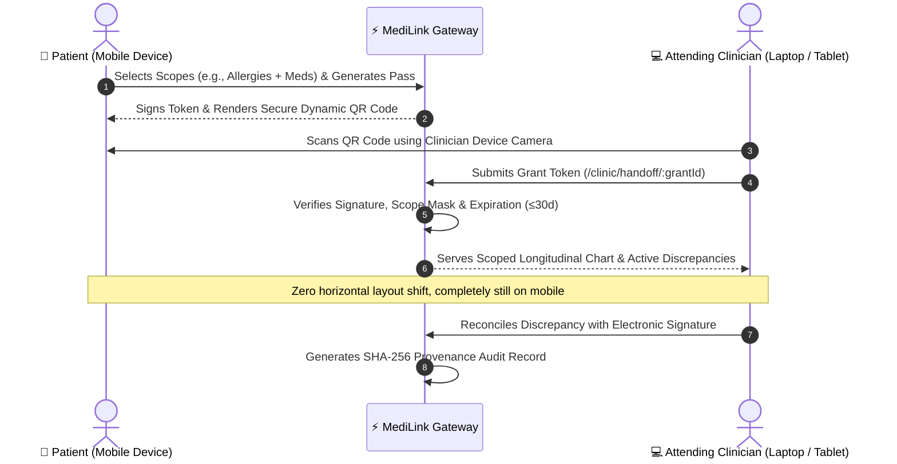

<div align="center">

# 🏥 MediLink PRO
### Cross-Institutional Health Records Continuity & Zero-Knowledge Consent Platform

[](https://www.typescriptlang.org/)
[](https://react.dev/)
[](https://tailwindcss.com/)
[](https://expressjs.com/)
[](https://hl7.org/fhir/R4/)
[](https://csrc.nist.gov/publications/detail/fips/180-4/final)
[](https://opensource.org/licenses/MIT)

<p align="center">
  <b>MediLink</b> bridges disparate Hospital Electronic Health Record (EHR) silos (Epic, Cerner, Allscripts) into an intelligent, patient-controlled continuity highway with automated contradiction detection, zero-knowledge scoped consent passes, and cryptographic audit ledgers.
</p>

[Key Features](#-key-features) •
[Architecture](#-system-architecture) •
[QR Clinical Handshake](#-2-device-qr-clinical-handshake) •
[Quick Start](#-quick-start) •
[Security & Compliance](#-security--cryptographic-audit-ledger) •
[Verification & Tests](#-automated-testing-suite)

---

</div>

## 📌 Executive Summary

Healthcare fragmentation directly endangers patient safety: **over 30% of preventable clinical errors stem from missing medical records or unflagged cross-hospital discrepancies** (e.g., conflicting allergy records, duplicative medication therapies, discontinued prescriptions).

**MediLink** solves this with a modern, patient-first architecture:
1. **Longitudinal Health Graph**: Merges fragmented FHIR R4 documents, laboratory panels, discharge summaries, and vital observations across independent hospital systems.
2. **Deterministic & Clinical Safety Engine**: Automatically detects contradictory records (such as Penicillin allergy flagged at one hospital but de-labeled after negative skin tests at an asthma clinic).
3. **Dynamic 2-Device QR Handoff**: Enables instantaneous, time-bound, category-scoped clinical passes to attending emergency or outpatient physicians via secure tokenized QR codes.
4. **Cryptographic Tamper-Evident Ledger**: Every access event, revocation, and clinical reconciliation is cryptographically signed and chained with SHA-256 provenance hashes.

---

## ✨ Key Features

### 👤 1. Patient Experience & Unified Timeline
- **Longitudinal Medical History**: Chronological view of inpatient admissions, lab results, and outpatient consultations across Memorial Hospital, Sutter Health, and regional clinics.
- **Granular Consent Management**: Real-time permission controls allowing patients to grant, expire, or immediately revoke clinical access by category (`Allergies`, `Medications`, `Lab Results`, `Clinical Notes`).
- **One-Click Instant Revocation**: Real-time invalidation of clinical tokens at the patient gateway.

### 🩺 2. Clinical Workspace & Provider Handoff
- **Active Clinical Handoff**: Dedicated, high-density clinical dashboard for attending physicians to review verified records, timeline summaries, and active medications.
- **Discrepancy Resolution Studio**: Side-by-side comparative reconciliation interface for clinicians to resolve conflicting assertions with electronic signatures and rationales.
- **Category Filter Enforcer**: Clinicians only see data categories explicitly authorized by the patient's active grant.

### 🛡️ 3. Safety & Contradiction Detection Engine
- **Conflict Classification**: Distinguishes true contradictions (e.g. `allergy_conflict` where one record asserts anaphylaxis and another records formal de-labeling) from valid chronological events (e.g. `dosage_escalation` from 500mg to 1000mg vs. duplicate therapy).
- **Patient Affirmation**: Patients can flag or affirm discrepancies prior to hospital visits to prepare attending doctors.

### 🔐 4. Cryptographic Audit Trail
- **Immutable Provenance Log**: Every read, export, consent creation, and reconciliation is recorded with SHA-256 integrity hashes, actor IDs, organization affiliations, and UTC timestamps.
- **Zero-Knowledge Architecture**: Verifiable verification without exposing un-scoped Protected Health Information (PHI).

---

## 📱 2-Device QR Clinical Handshake

MediLink features a real-world **2-Device Handshake** flow for clinical visits:



---

## 🏗️ System Architecture

```
medlink/
├── src/
│   ├── components/            # UI Design System & Navigation
│   │   ├── Navbar.tsx         # Responsive navbar with persona switcher & ⌘K palette
│   │   └── Footer.tsx         # Enterprise footer with legal & HIPAA references
│   ├── pages/                 # Full-Featured Application Views
│   │   ├── LandingPage.tsx    # High-converting clinical continuity landing page
│   │   ├── PatientDashboard.tsx # Patient overview, health cards, active alerts
│   │   ├── PatientHistory.tsx # Longitudinal medical chart across healthcare systems
│   │   ├── PatientConflicts.tsx # Patient discrepancy review & affirmation interface
│   │   ├── PatientConsents.tsx # Dynamic QR consent pass generator & revocation
│   │   ├── PatientImport.tsx  # FHIR R4 & EHR document ingestion pipeline
│   │   ├── PatientAccessHistory.tsx # SHA-256 cryptographic audit ledger viewer
│   │   ├── ClinicDashboard.tsx # Physician dashboard (Sutter Health / Dr. Vance)
│   │   ├── ClinicAccessRequest.tsx # Clinician record request workflow
│   │   └── ClinicHandoff.tsx  # Two-pane clinical reconciliation & handoff
│   ├── context/
│   │   └── AuthContext.tsx    # Multi-persona provider (Patient, Clinician, Auditor)
│   ├── server/                # In-Memory Deterministic Safety Engines
│   │   ├── contradictionEngine.ts # Medication & allergy discrepancy classifier
│   │   ├── consentEngine.ts   # Scope filter & token validation gateway
│   │   └── mockDb.ts          # Longitudinal FHIR seed database
│   ├── types/
│   │   └── medilink.ts        # Fully-typed clinical data contracts
│   ├── tests/
│   │   └── coreEngine.test.ts # Automated unit tests for safety & consent engines
│   └── App.tsx                # Single-page client router with popstate support
├── server.ts                  # Express backend API with Vite SSR/HMR integration
├── vite.config.ts             # Vite configuration with Tailwind CSS v4 & React
└── package.json               # Node.js project manifest & scripts
```

---

## 🚀 Quick Start

### Prerequisites
- **Node.js**: `v20.x` or higher (recommended: `v22.x`)
- **npm**: `v9.x` or higher

### Installation

1. **Clone the repository**:
   ```bash
   git clone https://github.com/jharajiv315/Medilink.git
   cd Medilink
   ```

2. **Install dependencies**:
   ```bash
   npm install
   ```

3. **Launch the development server**:
   ```bash
   npm run dev
   ```

4. **Access the application**:
   - **Local URL**: `http://localhost:3002`
   - **Network URL**: `http://<your-local-ip>:3002` (for live testing mobile phone QR scanning on the same Wi-Fi)

---

## 🧪 Automated Testing Suite

MediLink includes unit tests covering safety contradiction classification, consent verification, and handoff access rules:

```bash
npm test
```

### Test Coverage Highlights:
- ✔ **Allergy Conflict Detection**: Accurately flags allergy assertions with opposing polarity.
- ✔ **Dosage Escalation**: Differentiates therapeutic dosage titration from duplicate therapy.
- ✔ **Deterministic Scoping**: Verifies that non-approved categories are strictly stripped from clinical responses.
- ✔ **Revocation Verification**: Proves that revoked or expired passes return `403 Forbidden`.
- ✔ **Reconciliation Preservation**: Ensures physician resolutions remain intact when new FHIR data arrives.

---

## 🔒 Security & Cryptographic Audit Ledger

| Security Standard | MediLink Implementation |
| :--- | :--- |
| **HIPAA Security Rule** | Zero-Knowledge category scoping, role-based access control (RBAC), and session timeouts. |
| **Integrity Provenance** | Every event (view, export, dispute, reconcile) generates a **SHA-256 chained hash**. |
| **Mobile Stability** | Hardened against viewport bouncing and sub-pixel rubber-band shifts on iOS Safari & Chrome Android. |
| **Token Invalidation** | Instant revocation disables active QR passes across all active sessions in real time. |

---

## 👥 Demo Personas

MediLink includes pre-configured persona switches in the top navigation bar for testing:

1. **Ananya Sharma** (`Patient`)
   - Type 2 Diabetes, Asthma, Flagged Penicillin Discrepancy.
   - Controls active consent grants and manages data scopes.
2. **Dr. Marcus Vance, MD** (`Clinician - Sutter Health`)
   - Attending Emergency & Outpatient Physician.
   - Reviews clinical handoffs and completes signed reconciliations.
3. **Elena Rostova** (`Chief Compliance & Privacy Officer`)
   - Audits hospital ledger access, cryptographic provenance, and regulatory compliance.

---

## 📄 License

This project is licensed under the [MIT License](LICENSE). Built for modern, interoperable, and patient-first healthcare continuity.
