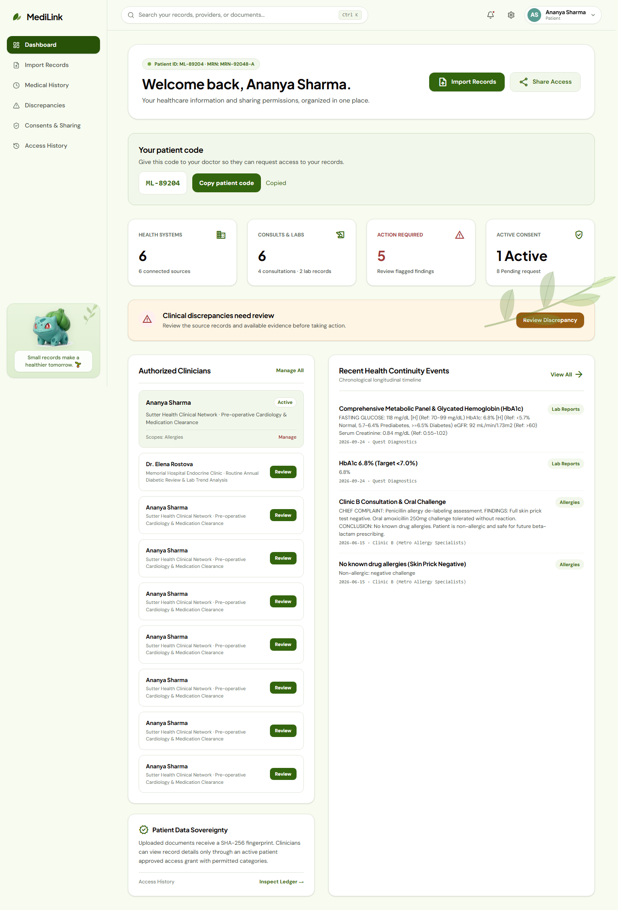
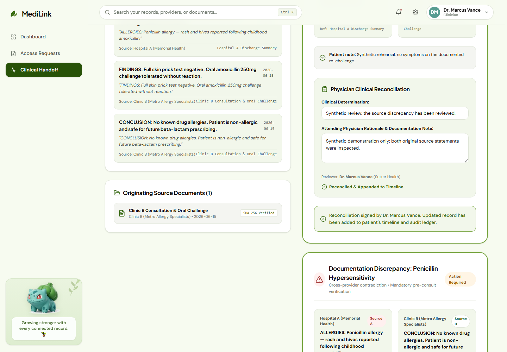
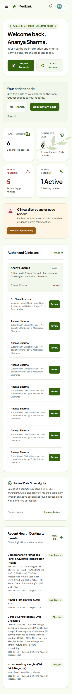
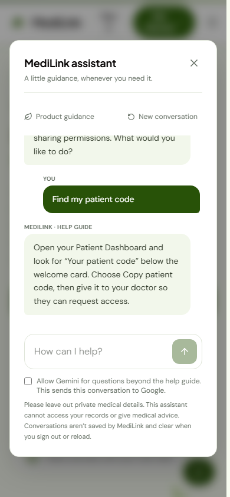

# MediLink

> Patient-controlled medical record sharing and clinical handoff for **JAVRIS 3.0**.

[](https://medilink-wheat-two.vercel.app/)
[](https://react.dev/)
[](https://expressjs.com/)
[](https://supabase.com/)

## Overview

MediLink gives patients one place to organize health records, inspect documented discrepancies, and control exactly what a clinician can access. Clinicians request time-limited, category-specific access and record a review appended to the patient timeline.

**[Open the live application](https://medilink-wheat-two.vercel.app/)** · [Live demo guide](docs/LIVE-DEMO.md) · [Supabase operations](docs/SUPABASE.md) · [Report an issue](https://github.com/jharajiv315/Medilink/issues)

> This is a demonstration application using synthetic clinical examples. It does not provide medical advice and does not claim HIPAA, SOC 2, or FHIR certification.

## Contents

- [Hackathon submission](#hackathon-submission)
- [Team](#team)
- [What the demo shows](#what-the-demo-shows)
- [Screenshots](#screenshots)
- [Product capabilities](#product-capabilities)
- [Architecture](#architecture)
- [Run locally](#run-locally)
- [Accounts and access](#accounts-and-access)
- [Testing](#testing)
- [Deployment](#deployment)
- [Folder structure](#folder-structure)
- [Security and scope](#security-and-scope)
- [License](#license)

## Hackathon submission

MediLink is the team’s **JAVRIS 3.0** submission. It addresses fragmented healthcare records with a patient-controlled workflow for evidence review, discrepancy handling, and secure clinical handoff.

The repository includes the runnable application, Vercel configuration, Supabase migration, integration scripts, visual assets, and live workflow evidence. The repository does not contain an official event brief, judging rubric, dates, or category assignment; those details should be added when the organizers publish them.

## Team

| Member | Primary focus |
| --- | --- |
| **Rajiv Jha** | Product direction, architecture, integration, and delivery |
| **Rangesh Gupta** | Engineering, application workflows, and validation |
| **Mitesh Jha** | Data, backend integration, and platform support |
| **Ansh Jaiswal** | Frontend experience, visual system, and presentation |

The team collaborated across the implementation; the table identifies the primary areas represented by each member.

## What the demo shows

1. A patient signs in and imports two source statements.
2. MediLink detects a documented discrepancy and preserves the source evidence.
3. The patient adds an affirmation for the clinician.
4. A doctor requests selected categories using the patient code.
5. The patient approves a duration and scopes the handoff.
6. The doctor reviews evidence and signs a reconciliation.
7. The patient can inspect audit history, revoke access, and observe denial.
8. A short-lived grant expires and is denied at the expiry boundary.

See [LIVE-DEMO.md](docs/LIVE-DEMO.md) and [LIVE-TEST-RESULTS.md](docs/LIVE-TEST-RESULTS.md).

## Screenshots

The UI uses a botanical Bulbasaur theme with sage surfaces, forest-green navigation, rounded clinical cards, responsive layouts, local artwork, and a compact support assistant. Select any image for the full-size snapshot.

<table>
<tr>
<td align="center"><strong>Patient dashboard</strong><br><a href="docs/snapshots/patient-dashboard-desktop.png"></a></td>
<td align="center"><strong>Clinical handoff</strong><br><a href="docs/snapshots/clinical-handoff-desktop.png"></a></td>
</tr>
<tr>
<td align="center"><strong>Patient dashboard on mobile</strong><br><a href="docs/snapshots/patient-dashboard-mobile.png"></a></td>
<td align="center"><strong>Support assistant on mobile</strong><br><a href="docs/snapshots/support-chat-mobile.png"></a></td>
</tr>
</table>

See the [medical history mobile snapshot](docs/snapshots/medical-history-mobile.png) for the responsive timeline and provenance cards.

## Product capabilities

### Patient workspace

- Private registration and sign-in.
- Health overview and searchable medical history timeline.
- Clinical text import with metadata, source references, hashes, and duplicate detection.
- Evidence-linked discrepancy review and patient statements.
- Category-specific consent with a selected duration.
- Local QR generation and authenticated handoff links.
- Account-scoped access history and audit events.
- Product-navigation help through **Ask MediLink**.

### Clinical workspace

- Administrator-provisioned doctor accounts.
- Patient-code access requests with purpose, categories, and duration.
- Active handoff dashboard and pending requests.
- Backend-enforced patient-scoped handoff payloads.
- Source comparison and clinician reconciliation with rationale.

### Platform

- Application-managed credentials and HttpOnly sessions.
- Supabase Postgres persistence through Supavisor.
- Request-isolated storage with row locking and commit-before-response behavior.
- Vercel deployment in Mumbai (`bom1`).
- Seeded chat guidance with optional server-side Gemini fallback.

## Architecture

```text
Browser: React 19 + Vite + Tailwind
  ├─ Marketing, auth, patient, clinician, and admin screens
  ├─ Shared UI, QR, chat, and botanical components
  └─ AuthContext + typed contracts
       │ same-origin HttpOnly session cookie
       ▼
Express API (server.ts)
  ├─ Authentication, role checks, consent, audit, and handoff routes
  ├─ Discrepancy processing and product chat
  └─ Request-isolated persistence adapter
       ├─ Supabase Postgres JSONB store in production
       └─ Isolated JSON store for local development and tests
```

The compatibility store preserves the existing application shape in a JSONB row. Mutations acquire a singleton row lock to prevent lost updates. A larger deployment should normalize identity and clinical entities, paginate records, and narrow queries.

## Run locally

Requirements: Node.js **24.x**, npm, and Git.

```bash
git clone https://github.com/jharajiv315/Medilink.git
cd Medilink
npm ci
npm run dev
```

Open [http://localhost:3002](http://localhost:3002). Express serves both the Vite frontend and API. On Windows, use `npm.cmd` if PowerShell blocks `npm.ps1`.

Copy `.env.example` to `.env`. For isolated JSON development, leave `SUPABASE_DATABASE_URL` empty and use an external file:

```dotenv
MEDILINK_DB_PATH=../medilink-local/store.json
```

For managed persistence, follow [docs/SUPABASE.md](docs/SUPABASE.md). Never commit populated environment files, credentials, database URLs, or backups.

## Accounts and access

| Role | Provisioning | Main route |
| --- | --- | --- |
| Patient | Public registration or existing account | `/patient/dashboard` |
| Clinician | Administrator-provisioned account | `/clinic/dashboard` |
| Administrator | Existing provisioned account | `/admin/clinicians` |

Patients use **Patient Sign In**. Doctors and administrators use **Clinical Team**. Doctors cannot self-register or switch personas. Demo credentials are distributed privately.

| Environment variable | Purpose |
| --- | --- |
| `SUPABASE_DATABASE_URL` | Restricted server-only Postgres connection |
| `MEDILINK_DB_PATH` | Optional isolated local JSON database path |
| `DEMO_PATIENT_PASSWORD` | Optional seeded patient password, minimum 12 characters |
| `CLINICIAN_PASSWORD` | Optional seeded clinician password, minimum 12 characters |
| `ADMIN_PASSWORD` | Optional seeded administrator password, minimum 12 characters |
| `GEMINI_API_KEY` | Optional server-only assistant key |
| `GEMINI_CHAT_MODEL` | Optional model; defaults to `gemini-2.5-flash` |
| `PORT` | Local port; defaults to `3002` |

## Testing

```bash
npm run lint
npm test
npm run build
```

Tests cover discrepancy classification, affirmation, reconciliation, consent expiry and revocation, authorization boundaries, import deduplication, database commit ordering, rollback behavior, chat validation, and audit preservation.

Run the live workflow only against a designated environment:

```bash
node --env-file=.env.supabase.local scripts/verify-live-demo.mjs https://medilink-wheat-two.vercel.app
```

The script creates and removes only its own synthetic fixtures and retains their audit events. The recorded run used isolated mobile and desktop Chromium contexts; it did not replace physical Safari or phone-camera testing.

## Deployment

Vercel uses the Vite build and `api/index.ts` Express adapter. `vercel.json` routes `/api/*`, supports deep links, and selects `bom1`. Configure `SUPABASE_DATABASE_URL` and required seed passwords as server-only Vercel variables.

```text
GET https://medilink-wheat-two.vercel.app/api/health
```

Expected response:

```json
{"status":"healthy","service":"MediLink Continuity Core","version":"1.0.0","storage":"supabase"}
```

## Folder structure

<details>
<summary>Show the complete repository map</summary>

```text
MediLink/
├── api/index.ts                 Vercel API adapter
├── src/
│   ├── App.tsx                  Client routes and portal shell
│   ├── main.tsx                 React entry point
│   ├── index.css                Global styles and design tokens
│   ├── components/              Shared UI, layout, chat, and botanical theme
│   ├── context/                 Client authentication state
│   ├── pages/                   Landing, auth, patient, clinician, and admin screens
│   ├── server/                  Persistence, TLS, chat handler, and API tests
│   ├── types/                   Shared TypeScript contracts
│   └── utils/                   Consent, discrepancy, and extraction engines
├── public/assets/               Healthcare photography and botanical artwork
├── scripts/                     Migration, import, cleanup, and live verification
├── supabase/migrations/         Database schema and runtime permissions
├── docs/                        Operations, demo guide, results, and snapshots
├── data/medilink_store.json     Synthetic local seed/demo dataset
├── server.ts                    Express routes and authentication
├── vercel.json                  Production routing and function region
├── package.json                 Scripts and dependencies
├── .env.example                 Environment variable template
└── LICENSE                      Project usage terms
```

</details>

## Security and scope

- Passwords use salted scrypt hashes; sessions use opaque server-side tokens.
- Production cookies are HttpOnly, Secure, and SameSite=Strict.
- Backend authorization checks roles, ownership, assigned clinicians, categories, grant status, revocation, and expiry.
- The Supabase runtime role is restricted to private storage; anonymous clients have no direct clinical-data access.
- Database TLS verifies Supabase’s public root CA.
- Imported clinical text receives SHA-256 provenance fingerprints.
- Audit events are preserved and fingerprinted; the implementation is not an externally immutable chained ledger.
- Import accepts clinical text and metadata; it does not implement live Epic/Cerner connections, PDF OCR, or a general FHIR server.
- Discrepancy detection is deterministic and does not diagnose or recommend treatment.
- QR images are generated locally; handoff URLs still require clinician authentication and grant authorization.

## License

Copyright © 2026 Rajiv Jha, Rangesh Gupta, Mitesh Jha, and Ansh Jaiswal. All rights reserved.

The source, artwork, screenshots, clinical seed data, and documentation are provided for JAVRIS 3.0 demonstration and evaluation. No permission is granted to copy, redistribute, sell, or reuse the project or its assets without written permission. Third-party packages remain under their respective licenses.

## Contributing

Open an issue with the affected workflow, expected behavior, and reproduction steps. Keep pull requests focused, preserve authorization boundaries, and run the standard checks before submitting. Never include real patient information, credentials, or private database exports.
