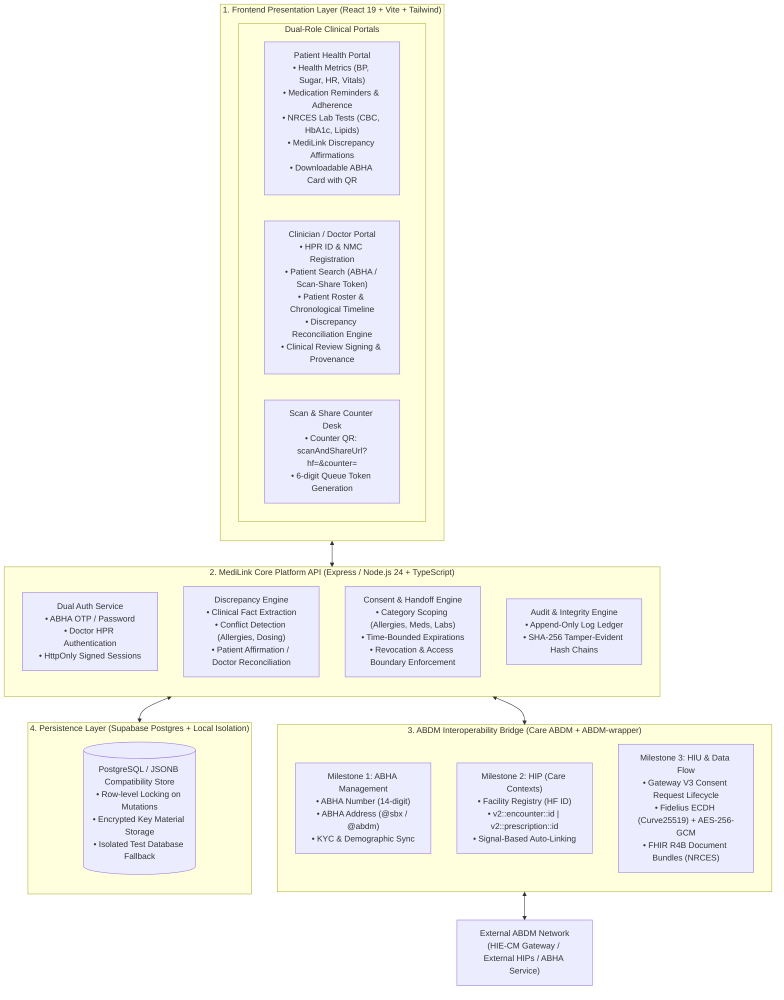
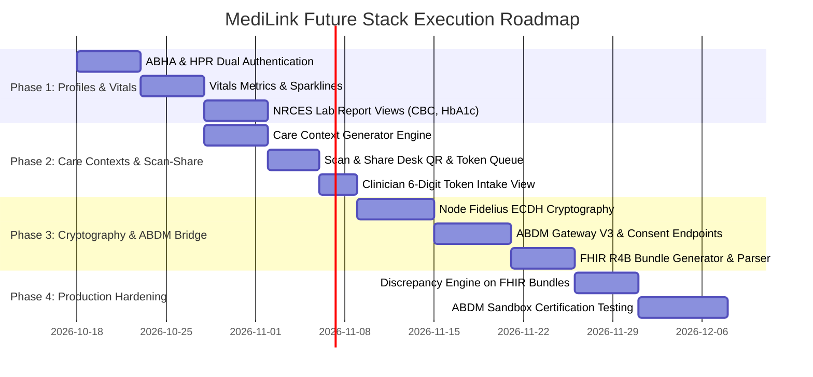

# MediLink: Future Stack Architecture & Engineering Roadmap
> **A Source-Grounded, ABDM-Compliant Health Record Exchange & Clinical Reconciliation Platform**  
> *Synthesized from MediLink Core, `shamiquekhan/mediarchive`, `NHA-ABDM/ABDM-wrapper`, and `10bedicu/care_abdm`.*

---

## 1. Reference Sources & Upstream Repositories

Every architectural decision and specification in this document directly maps to these upstream source repositories and technical standards:

### 1.1 MediArchive (Clinical Portals & Dual Auth)
* **Repository**: [https://github.com/shamiquekhan/mediarchive](https://github.com/shamiquekhan/mediarchive)
* **Live Demo**: [https://mediarchive.vercel.app](https://mediarchive.vercel.app)
* **Key Components Referenced**:
  * [src/services/authService.js](https://github.com/shamiquekhan/mediarchive/blob/main/src/services/authService.js) — Dual-role authentication for ABHA ID & Doctor HPR ID.
  * [src/components/PatientDashboard.jsx](https://github.com/shamiquekhan/mediarchive/blob/main/src/components/PatientDashboard.jsx) — Patient health vitals metrics (BP, glucose, heart rate), medication reminders, and test results.
  * [src/components/DoctorDashboard.jsx](https://github.com/shamiquekhan/mediarchive/blob/main/src/components/DoctorDashboard.jsx) — Doctor practice roster, appointment queues, and clinical timelines.
  * [src/components/PatientSearch.jsx](https://github.com/shamiquekhan/mediarchive/blob/main/src/components/PatientSearch.jsx) — Rapid patient search by ID and demographics.

### 1.2 Care ABDM (10BedICU / Open Healthcare Network)
* **Backend Repository**: [https://github.com/10bedicu/care_abdm](https://github.com/10bedicu/care_abdm)
* **Frontend Plugin**: [https://github.com/10bedicu/care_abdm_fe](https://github.com/10bedicu/care_abdm_fe)
* **Core Technical Specification**: [care_abdm/ABDM_INTEGRATION.md](https://github.com/10bedicu/care_abdm/blob/develop/ABDM_INTEGRATION.md)
* **Key Components Referenced**:
  * [abdm/utils/fidelius.py](https://github.com/10bedicu/care_abdm/blob/develop/abdm/utils/fidelius.py) — Curve25519 ECDH + HKDF-SHA256 + AES-256-GCM (Fidelius) end-to-end encryption.
  * [abdm/service/v3/gateway.py](https://github.com/10bedicu/care_abdm/blob/develop/abdm/service/v3/gateway.py) — ABDM Gateway V3 API orchestration (tokens, consent, and data transfer).
  * [abdm/service/v3/health_id.py](https://github.com/10bedicu/care_abdm/blob/develop/abdm/service/v3/health_id.py) — ABHA V3 creation and login APIs.
  * [abdm/utils/fhir/](https://github.com/10bedicu/care_abdm/tree/develop/abdm/utils/fhir) — NRCES-compliant FHIR R4B document bundle builders.
  * [abdm/signals/register_care_contexts.py](https://github.com/10bedicu/care_abdm/blob/develop/abdm/signals/register_care_contexts.py) — Automated care context generation (`v2::<model>::<id>`).
  * [abdm/utils/token.py](https://github.com/10bedicu/care_abdm/blob/develop/abdm/utils/token.py) — Scan & Share desk queue token lifecycle.

### 1.3 National Health Authority (NHA-ABDM)
* **GitHub Organization**: [https://github.com/NHA-ABDM](https://github.com/NHA-ABDM)
* **Primary Integration Wrapper**: [NHA-ABDM/ABDM-wrapper](https://github.com/NHA-ABDM/ABDM-wrapper) — Official Spring Boot / MongoDB middleware for HIP & HIU workflows.
* **Testing & Reference Implementations**:
  * [NHA-ABDM/ABDM-MOCK-HIP](https://github.com/NHA-ABDM/ABDM-MOCK-HIP) — V3 API-compliant mock HIP service for local integration testing.
  * [NHA-ABDM/ABDM-ABHA-APP](https://github.com/NHA-ABDM/ABDM-ABHA-APP) — Skeletal Dart/Flutter codebase for the patient ABHA application.
  * [NHA-ABDM/UHI](https://github.com/NHA-ABDM/UHI) — Unified Health Interface protocol specs (Beckn protocol for telemedicine).
  * [NHA-ABDM/nhcx](https://github.com/NHA-ABDM/nhcx) — National Health Claims Exchange.
* **Official Portals & Specifications**:
  * [ABDM Sandbox Portal](https://sandbox.abdm.gov.in/) — Sandbox documentation, API keys, and testing environments.
  * [NRCES India FHIR R4 Profiles](https://nrces.in/) — National Resource Centre for EHR standards in India.

---

## 2. Executive Summary & Vision

MediLink is evolving into a comprehensive, national-standard digital health platform. By integrating the best-in-class patterns from:
1. **`NHA-ABDM/ABDM-wrapper`**: Official Indian National Health Authority gateway bridge for Milestones 1, 2, and 3.
2. **`10bedicu/care_abdm`**: Gold-standard open-source production EMR architecture featuring **Fidelius Curve25519 ECDH cryptography**, **FHIR R4B NRCES bundles**, **automated Care Context linking**, and **Scan & Share desk tokens**.
3. **`shamiquekhan/mediarchive`**: Clean dual-role identity (**ABHA ID** & **HPR ID**), patient vitals dashboard (BP, Glucose, HR, Vitals), structured lab reports (CBC, HbA1c), medication reminders, and single/multi-doctor practice management.
4. **`MediLink Core`**: Proprietary **clinical discrepancy detection**, **patient affirmation**, **category-scoped time-limited consents**, and **tamper-evident SHA-256 audit ledgers**.

---

## 3. High-Level System Architecture



---

## 4. Detailed Technology Stack

| Layer | Component | Chosen Technology | Rationale / Source Pattern |
| :--- | :--- | :--- | :--- |
| **Frontend UI** | Core Framework | **React 19 + TypeScript + Vite** | High performance, typed contracts, sub-millisecond HMR. |
| **Styling & Theme** | Design System | **Tailwind CSS + Botanical Theme** | Forest green (`#1b4332`), sage surfaces (`#e8f5e9`), high contrast, clinical accessibility. |
| **Icons & Media** | UI Icons | **Lucide React** + Local SVG Badges | Medical icons (activity, heart, pill, shield, qr-code). |
| **FHIR Rendering** | Medical Viewer | **NRCES-compliant FHIR R4 Viewer** | Lightweight component inspired by `hi-profiles` to render DiagnosticReport, Prescription, and OPConsultation. |
| **Backend API** | App Server | **Express 4 / Node.js 24 + TypeScript** | Native ES modules, unified server with Vite, enterprise stability. |
| **ABDM Integration** | Bridge & Gateway | **`ABDM-wrapper` + `Care ABDM` V3 services** | Official NHA wrapper interfaces for V3 APIs, session handling, and webhook callbacks. |
| **Cryptography** | End-to-End Encryption | **Fidelius ECDH (Curve25519) + HKDF + AES-GCM** | Mandatory ABDM standard for transferring encrypted health information between HIP and HIU. |
| **Database** | Primary Store | **Supabase PostgreSQL** | Row-level security, JSONB compatibility for agile clinical schemas, Supavisor connection pooling. |
| **Local Dev Store** | Development Mock | **Request-Isolated JSON Store** | Zero-dependency local prototyping and CI/CD testing without cloud lock-in. |

---

## 5. Enhanced Domain Data Model

### 5.1 Identity & Registry Entities
```typescript
// ABHA Identity (from ABDM M1 & MediArchive)
export interface AbhaProfile {
  abhaNumber: string;         // '14-digit format: XX-XXXX-XXXX-XXXX'
  healthId: string;           // 'handle@sbx' or 'handle@abdm'
  name: string;
  gender: 'M' | 'F' | 'O';
  dateOfBirth: string;        // 'YYYY-MM-DD'
  mobile: string;
  email?: string;
  address: string;
  district: string;
  state: string;
  pincode: string;
  profilePhoto?: string;      // Base64 or signed URL
  isVerified: boolean;
}

// Healthcare Professional Registry (from MediArchive & ABDM)
export interface HprProfile {
  hprId: string;              // 'dr.vance@hpr' or '91-XXXX-XXXX-XXXX'
  nmcRegistrationNumber: string;
  stateCouncil: string;
  qualification: string;
  specialty: string;
  hospitalAffiliation: string;
  experienceYears: number;
}
```

### 5.2 Clinical Vitals & Lab Reports (MediArchive)
```typescript
export interface VitalSignsMetric {
  id: string;
  patientId: string;
  timestamp: string;
  bloodPressureSystolic: number;   // mmHg
  bloodPressureDiastolic: number;  // mmHg
  bloodSugarFasting?: number;      // mg/dL
  bloodSugarPostPrandial?: number; // mg/dL
  heartRateBpm: number;
  spO2Percent: number;
  temperatureF?: number;
  weightKg?: number;
  heightCm?: number;
  recordedBy: string;
}

export interface StructuredLabTest {
  id: string;
  patientId: string;
  testCategory: 'CBC' | 'LIPID_PROFILE' | 'HBA1C' | 'METABOLIC' | 'LIVER_FUNCTION';
  testName: string;
  specimenDate: string;
  reportingDate: string;
  results: {
    parameter: string;           // e.g. 'Hemoglobin', 'Platelet Count', 'HbA1c'
    value: number | string;
    unit: string;                // e.g. 'g/dL', '%', 'mg/dL'
    referenceRange: string;      // e.g. '13.5 - 17.5 g/dL'
    status: 'normal' | 'low' | 'high' | 'critical';
  }[];
  laboratoryName: string;
  signoffDoctor: string;
  fhirBundleId?: string;
}

export interface ActivePrescription {
  id: string;
  patientId: string;
  medicationName: string;
  dosage: string;                // e.g. '500 mg'
  frequency: 'Once Daily' | 'Twice Daily' | 'Thrice Daily' | 'As Needed';
  timing: 'Before Meals' | 'After Meals' | 'At Bedtime';
  startDate: string;
  endDate?: string;
  prescribingDoctor: string;
  instructions: string;
  adherenceRatePercent?: number;
}
```

### 5.3 ABDM Care Contexts, Fidelius Crypto & Consent Artefacts (Care ABDM)
```typescript
export interface CareContext {
  referenceNumber: string;       // e.g. 'v2::diagnostic_report::101'
  display: string;               // 'Complete Blood Count (CBC) - 12 Oct 2026'
  hiType: 'DiagnosticReport' | 'Prescription' | 'OPConsultation' | 'DischargeSummary';
  clinicalDate: string;
}

export interface FideliusKeyMaterial {
  algorithm: 'ECDH';
  curve: 'Curve25519';
  publicKey: string;             // Base64 Curve25519 public key
  privateKey?: string;           // Kept internal on backend
  nonce: string;                 // Base64 32-byte nonce
}

export interface AbdmConsentArtefact {
  id: string;                    // UUID
  requestId: string;
  patientAbha: string;
  hiuId: string;                 // e.g. 'IN2710001234'
  hipId: string;
  purpose: 'CAREMGT' | 'BTG' | 'PUBHLTH' | 'PATRQT';
  hiTypes: ('Prescription' | 'DiagnosticReport' | 'OPConsultation' | 'DischargeSummary')[];
  dateRange: { from: string; to: string };
  expiry: string;
  status: 'REQUESTED' | 'GRANTED' | 'DENIED' | 'EXPIRED' | 'REVOKED';
  keyMaterial?: FideliusKeyMaterial;
  signature?: string;
}

export interface ScanAndShareQueueToken {
  tokenNumber: string;           // 6-digit queue code e.g. '482-109'
  facilityId: string;
  counterId: string;
  patientAbha: string;
  demographics: {
    name: string;
    gender: string;
    dob: string;
    mobile: string;
  };
  generatedAt: string;
  expiresAt: string;            // Default 30 min TTL
  status: 'PENDING' | 'CLAIMED' | 'EXPIRED';
}
```

---

## 6. End-to-End Workflow Blueprints

### Flow A: Registration Desk "Scan & Share"
1. **Clinic Desk Screen**: Displays a dynamic QR code for Counter #1:
   `https://medilink.app/scan-and-share?hf=IN2710001234&counter=1`
2. **Patient Scan**: Patient scans QR code with their ABHA app (or MediLink mobile view) and approves sharing.
3. **Queue Token**: MediLink backend generates a short-lived 6-digit token (`Token: 591-204`, 30-min expiry).
4. **Instant Intake**: Front desk or doctor types `591-204` into `TokenSearchDialog`. The patient profile, previous medical summary, and active discrepancies load instantly without manual data entry.

### Flow B: HIU Consent Request & Fidelius Transfer
1. **Clinician Request**: Clinician initiates record request selecting Purpose (`CAREMGT`), Date Range, and Categories.
2. **Consent Artefact**: Patient receives notification and approves via their ABHA portal.
3. **Key Exchange**: MediLink generates an ephemeral **Curve25519 ECDH keypair** and nonce.
4. **Encrypted Transfer**: The external HIP encrypts the FHIR bundle with AES-256-GCM using the shared secret.
5. **Decryption & Ingestion**: MediLink HIU endpoint decrypts the bundle using its private key and the HIP's public key.
6. **Discrepancy Analysis**: MediLink's Discrepancy Engine automatically inspects the decrypted clinical facts against existing records (e.g., flagging active Penicillin allergy vs. recent negative allergy challenge) and renders it for clinician reconciliation.

---

## 7. Phased Implementation Roadmap



### Phase 1: Identity & Rich Clinical Health Portal
- [ ] Implement dual-role login (Patient ABHA ID / Doctor HPR ID) alongside existing email login.
- [ ] Build **Vitals & Health Metrics Widget** on Patient Dashboard (BP, Fasting Blood Sugar, Heart Rate, BMI).
- [ ] Build **Lab Diagnostic Reports Center** with test breakdown (CBC, Lipid Panel, HbA1c) and simulated report download.
- [ ] Build **Active Prescriptions List** with daily dose reminder badges.
- [ ] Render official **Downloadable ABHA Card** with QR code and demographic card.

### Phase 2: Care Contexts & Scan-and-Share Onboarding
- [ ] Add `HealthFacility` registry model (`hf_id` e.g., `IN2710001234`).
- [ ] Create Care Context format: `v2::<model>::<id>`.
- [ ] Build Desk **Scan & Share QR Generator** and 30-minute queue token store.
- [ ] Implement 6-digit token search dialog on Clinician Dashboard for instant patient intake.

### Phase 3: ABDM Interoperability & Fidelius Cryptography
- [ ] Implement Node.js native Curve25519 ECDH + HKDF-SHA256 + AES-256-GCM cryptography module (`fideliusCrypto.ts`).
- [ ] Build ABDM Gateway V3 endpoints (`/api/abdm/v3/*` for consent, care context linking, and data transfer).
- [ ] Integrate NRCES-compliant FHIR R4B Document Bundle serializers (`DiagnosticReport`, `Prescription`, `OPConsultation`).

### Phase 4: Full Pipeline Integration & Certification Readiness
- [ ] Pipe ingested FHIR documents directly into MediLink's Discrepancy Engine to detect clinical conflicts across institutions.
- [ ] Connect with `ABDM-wrapper` mock gateway to validate Milestones 1, 2, and 3.
- [ ] Perform tamper-evident audit ledger tests across all ABDM and clinical reconciliation events.
